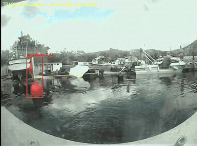
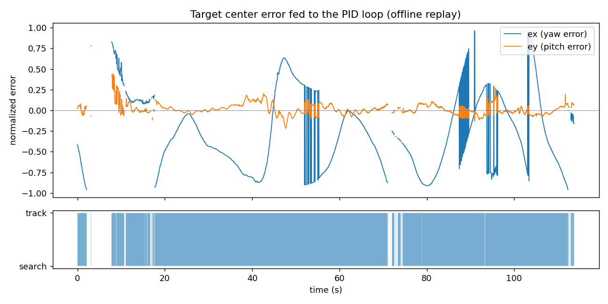

# USV Buoy Tracker — Real-time buoy detection & gimbal tracking on Jetson Orin Nano

[](https://github.com/jfsilverhand/usv-buoy-tracker/actions/workflows/tests.yml)

Vision and camera-control stack for the **AURA** team's unmanned surface vehicle (Kocaeli University). A DeepStream pipeline detects colored buoys in the gimbal camera's RTSP stream and a PID loop steers the SIYI A8 mini gimbal to keep the target centered. The whole stack ships as one Docker image, so any Jetson in the team runs it with `./run.sh`.



*Offline replay of footage recorded by the vehicle camera in 2025, through the buoy model.*

## Pipeline

```
SIYI A8 mini ──RTSP/H.264──► rtspsrc ► nvv4l2decoder (HW decode)
                                   ► nvstreammux 1280×720
                                   ► nvinfer  YOLOv8 · TensorRT FP16
                                   ► nvtracker (NvDCF)
                                   ► nvdsosd ► display
                                        │
                              pad probe (pyds): pick highest-confidence target
                                        │
                   normalized center error (x, y) ► PID yaw / PID pitch
                                        │
                      SIYI SDK over TCP :37256 (CRC16 frames) ► gimbal
```

## Hardware & software

| | |
|---|---|
| Compute | NVIDIA Jetson Orin Nano, JetPack 6 (L4T r36.4) |
| Camera / gimbal | SIYI A8 mini — RTSP `main.264` stream, control over TCP 37256 |
| Stack | DeepStream 7.1, TensorRT 10.3 (FP16), CUDA 12.6, GStreamer, Python 3.10 (pyds) |
| Models | Buoy detector: YOLOv8n, 5 classes (red, yellow, black, orange, green) — **not included in the repo** (see Credits). The code expects `best.onnx` (standard Ultralytics export, used by `vision_test.py` / `offline_eval.py`) and `best_ds.onnx` (DeepStream-Yolo export, used by `ds_main.py`) · `yolov8n_coco.onnx` — COCO demo model (Ultralytics) |
| Deployment | Docker image [`erengwen/usv-buoy-tracker`](https://hub.docker.com/r/erengwen/usv-buoy-tracker) + `setup.sh` / `run.sh` |

## What's in the repo

| File | What it does |
|---|---|
| `src/ds_main.py` | Main DeepStream app: builds the GStreamer pipeline, reads detections from DeepStream metadata in a pad probe, runs the PID loop, sends gimbal commands |
| `src/siyi_gimbal.py` | SIYI A8 mini driver written from the SIYI SDK protocol: packet framing, CRC16, firmware query, centering, yaw/pitch speed control, attitude polling thread |
| `src/pid_controller.py` | PID with deadzone, integral clamping and output saturation (separate yaw and pitch loops) |
| `src/vision_test.py` | Benchmark tool: GPU-decoded RTSP/video/webcam input, TensorRT inference, rolling FPS (avg / min / p95) and inference latency (avg / p95) |
| `src/yolov8_trt.py` | Standalone TensorRT (PyCUDA) YOLOv8 wrapper: letterbox preprocessing, decoding, NMS |
| `src/main.py` | Fallback tracker without DeepStream (OpenCV + TensorRT) |
| `tools/offline_eval.py` | Offline replay of recorded video: detection rate, lock continuity, target switches, PID error signal, annotated demo |
| `configs/` | nvinfer, nvtracker (default + baseline for A/B) and label configs |
| `tools/export_for_deepstream.sh` | Re-exports a YOLOv8 `.pt` with DeepStream-Yolo's exporter so `nvinfer` can parse it |
| `tools/x86_smoke_test.sh` | Runs the DeepStream pipeline end to end on any x86 NVIDIA GPU (parser build, engine build, 300 frames to mp4) |
| `Dockerfile`, `entrypoint.sh`, `setup.sh`, `run.sh` | One-command setup and run. The image is pulled from Docker Hub (or built with `BUILD=1`); TensorRT engines are built on the first run on the target device and kept in `models/` |

## Engineering notes

- **Hardware decode + frame dropping.** `nvv4l2decoder` decodes H.264 on the GPU. The `appsink` uses `max-buffers=1 drop=true`, so the tracker always works on the newest frame instead of a growing queue.
- **Engines are built on the device.** TensorRT engines are tied to the GPU and the TensorRT version, so the repo ships ONNX only. `nvinfer` builds the DeepStream engine from `onnx-file` on first launch; `entrypoint.sh` runs `trtexec --fp16` for the PyCUDA benchmark path.
- **Two ONNX exports of the same weights.** The DeepStream-Yolo parser expects its own export layout (boxes / scores / classes outputs), not Ultralytics' default `[1, 4+nc, 8400]` tensor. `best.onnx` keeps the standard layout for the PyCUDA/ONNX Runtime tools; `best_ds.onnx` is the DeepStream one.
- **Sticky target selection.** `ds_main.py` locks onto the nvtracker `object_id` and only re-selects when that track disappears — the offline evaluation below showed that re-picking the highest-confidence box every frame made the target jump between buoys.
- **Everything is one bind mount.** The project directory is mounted at `/workspace`, so the parser `.so`, engines and configs built inside the container persist on the host and are visible to `git status` (and ignored where they should be).
- **Graceful degradation.** If the gimbal doesn't answer, the app keeps running in detection-only mode.

## Offline evaluation (Sep 2026)

Replay of 114 s (3,414 frames, 1366×1012) of footage recorded by the vehicle camera on the water in 2025, run through `models/best.onnx` with the same confidence threshold as `ds_main.py` (0.40). Script: [`tools/offline_eval.py`](tools/offline_eval.py). This is a post-hoc evaluation on recorded video, not a live on-vehicle run.

| Metric | Value |
|---|---|
| Frames with ≥ 1 buoy detected | **91.9 %** |
| Detections by class | red 2,157 · green 1,096 · black 482 · yellow 2 · orange 0 |
| Longest continuous lock | 54.2 s |
| Lock losses / median re-acquisition | 9 / 0.33 s |
| **Target switches: highest-confidence selection (original `ds_main.py`)** | **63** |
| **Target switches: sticky selection (keep current target while IoU > 0.3)** | **7 (−89 %)** |



**Finding.** With two buoys in view, picking the highest-confidence box each frame makes the target jump between them (the spikes in the plot). On the vehicle that shows up as the gimbal snapping back and forth. Keeping the current target while it is still visible removes 89 % of those switches. `ds_main.py` now does this by locking onto the nvtracker `object_id` (`STICKY_TARGET = True`) instead of re-selecting by confidence every frame; the live effect on the gimbal has not been measured yet.

**Limitations.** There are no ground-truth labels for this footage, so these are detection and continuity statistics, not precision/recall. Spot-checking sampled frames shows occasional false "black buoy" detections on dark objects (e.g. a boat cover). The camera in this recording was not under gimbal control, so the error signal reflects the vehicle's heading, not gimbal performance.

## DeepStream pipeline, end to end (Oct 2026)

The same footage through the full `ds_main.py` pipeline (decode → nvinfer TensorRT FP16 → NvDCF tracker → sticky target selection → OSD → H.264 encode), run with `tools/x86_smoke_test.sh` in NVIDIA's DeepStream 7.1 container on a laptop RTX 3050 Ti. This verifies the pipeline and its configs; it is **not** a Jetson frame-rate measurement.

| Metric | Value |
|---|---|
| Frames | 3,414 (114 s) |
| Frames with a locked target | **88.7 %** (offline detector-only replay: 91.9 % — the tracker needs 3 consecutive matches before a buoy becomes a target) |
| Locked-target frames by class | red 1,974 · green 824 · black 230 |
| Throughput (x86 laptop GPU) | ~295 FPS headless · ~150 FPS with OSD + H.264 encode |

**Tracker tuning, measured.** Watching the output showed that a buoy seen from far away, missed by the detector for a few frames, and then approached got a *new* tracker ID — the box grows quickly as the boat closes in, and the original NvDCF settings dropped a track after ~1 s and required boxes of similar size to match. On the vehicle that is a moment where the gimbal loses its target and has to re-acquire. I kept the detector fixed and changed only the tracker (`configs/tracker_config_baseline.yml` → `configs/tracker_config.yml`): shadow-tracking age 1 s → 3 s, size-similarity threshold 0.6 → 0.3, visual-similarity threshold 0.7 → 0.5, and a longer tracklet re-association window.

| Tracker config | Target switches | Distinct target IDs | Locks | Frames with target |
|---|---|---|---|---|
| baseline | 15 | 11 | 26 | 88.0 % |
| re-acquisition (default) | **8 (−47 %)** | **9** | 21 | **88.7 %** |

"Target switch" = the locked target jumps directly from one tracker ID to another; it counts both a real change of buoy and the same buoy being re-issued a new ID. Reproduce with `python3 src/ds_main.py --src <video> --sink fake --no-gimbal --tracker configs/tracker_config_baseline.yml`.

**Known gap (data, not code).** At close range a black buoy whose flag is tilted is often missed, while the same buoy is detected from further away. The training set has few close-up, tilted-flag examples; the fix is more data from that viewpoint, not a lower threshold.

## Jetson performance

Measured on the vehicle's Jetson Orin Nano on 9 May 2026 with `src/vision_test.py` (GPU decode → TensorRT FP16 → post-process) inside the Docker image, on the live RTSP stream of the SIYI A8 mini, 120 s per model, confidence 0.35:

| Detector (5 buoy classes) | FPS avg | FPS p95 | TensorRT inference avg | TensorRT p95 | Frames |
|---|---|---|---|---|---|
| YOLOv8n (the model used here) | 25.3 | 32.8 | 18.8 ms | 20.1 ms | 2,905 |
| YOLO26n | 25.4 | 35.1 | 17.3 ms | 18.0 ms | 2,902 |

Both models reach almost the same frame rate although YOLO26n is 1.5 ms faster per inference, which points to the camera stream, not the GPU, as the limit. The run used a dark-background test scene, so its detection counts say nothing about accuracy and are not reported.

The DeepStream app (`ds_main.py` with the NvDCF tracker) was not benchmarked separately on the Jetson. To measure it: `./run.sh track --src <rtsp-or-video> --sink fake --no-gimbal` prints `avg_fps` in its `[SUMMARY]` line.

## Quick start (Jetson)

```bash
git clone --recursive https://github.com/jfsilverhand/usv-buoy-tracker
cd usv-buoy-tracker
./setup.sh                # pulls the image (BUILD=1 ./setup.sh builds it locally),
                          # compiles the DeepStream-Yolo parser, fixes tracker config, builds the COCO engine

# one-time, on any machine with Python: export your YOLOv8 weights for DeepStream
# (the buoy model is not published; with a different class count, update configs/labels.txt
#  and num-detected-classes in configs/config_infer_primary_yolov8.txt)
pip install ultralytics onnx onnxslim onnxruntime
tools/export_for_deepstream.sh models/best.pt      # -> models/best_ds.onnx

./run.sh                  # DeepStream tracking (src/ds_main.py); first run builds the TRT engine (~5 min)
./run.sh test             # benchmark (src/vision_test.py)
RTSP_URI=rtsp://<cam>:8554/main.264 GIMBAL_IP=<cam> ./run.sh   # different camera
```

Requirements: Jetson Orin (JetPack 6 / L4T r36.4), Docker with `nvidia-container-toolkit`, an X display for the preview window. The Docker image is built for `linux/arm64` (Jetson) only; on x86 use the route in the next section.

## Running without the vehicle

`ds_main.py` takes a video file instead of the RTSP camera and can write its output to an mp4, so the full DeepStream path (decode → nvinfer → nvtracker → OSD) can be exercised and recorded without the boat:

```bash
./run.sh track --src videos/aura_2025_run.mp4 --sink file --out eval/ds_out.mp4 --no-gimbal
./run.sh track --src videos/aura_2025_run.mp4 --sink fake --max-frames 300 --no-gimbal   # headless check
```

The same code runs on an x86 GPU inside NVIDIA's `deepstream:7.1-triton-multiarch` container (`nvinfer` config paths are relative to the config file, so the repo can live anywhere). `tools/x86_smoke_test.sh` installs pyds, compiles the DeepStream-Yolo parser, builds the TensorRT engine from `best_ds.onnx` and processes 300 frames to `eval/ds_smoke.mp4` — a 10-minute check on a rented GPU when no Jetson is at hand. It validates the pipeline, not Jetson frame rates.

## Tests

Unit tests run on every push in GitHub Actions (CPU only, no Jetson needed):

```bash
pip install -r requirements-dev.txt
pytest -q
```

- `tests/test_siyi_gimbal.py`: packet framing, sequence numbers and CRC16 against the fixed example frames published with the SIYI SDK; attitude reply decoding (yaw, pitch, roll in 0.1°); speed clamping.
- `tests/test_pid_controller.py`: P, I and D terms with a fake clock, deadzone, output saturation, integral clamp (anti-windup), time-gap guard.
- `tests/test_offline_eval.py`: letterbox geometry, tensor layout, box decoding back to frame coordinates, per-class NMS.

Writing the gimbal tests against SIYI's reference frames caught two bugs in the driver: the CRC16 used the wrong polynomial table (CRC-16/ARC instead of the protocol's CCITT X^16+X^12+X^5+1), and the attitude reply was decoded at the wrong offsets and scale. Both are fixed in `src/siyi_gimbal.py`; the fixed packets match the SDK examples byte for byte, and the change still needs a re-check on the gimbal itself.

## Credits

- DeepStream-Yolo custom parser: [marcoslucianops/DeepStream-Yolo](https://github.com/marcoslucianops/DeepStream-Yolo)
- YOLOv8: Ultralytics
- Team: AURA (Kocaeli University, unmanned surface & underwater vehicles). The vehicle, electronics and navigation stack are the team's work; the dataset was collected by the team.

My role: I wrote this repository — DeepStream pipeline, SIYI gimbal driver, PID tracking, benchmark and evaluation tools, the Docker packaging — and I trained the buoy detector (YOLOv8n, 5 classes) on the team's dataset. The dataset and the trained model (PyTorch weights and ONNX exports) are not published: it is the team's competition model. All results above were produced with it; the GIF above shows its output.

## License

Code in this repository: MIT (see [LICENSE](LICENSE)). Third-party parts keep their own licenses: `deepstream_yolo/` (DeepStream-Yolo, MIT) and `models/yolov8n_coco.onnx` (Ultralytics YOLOv8n COCO weights, AGPL-3.0).
